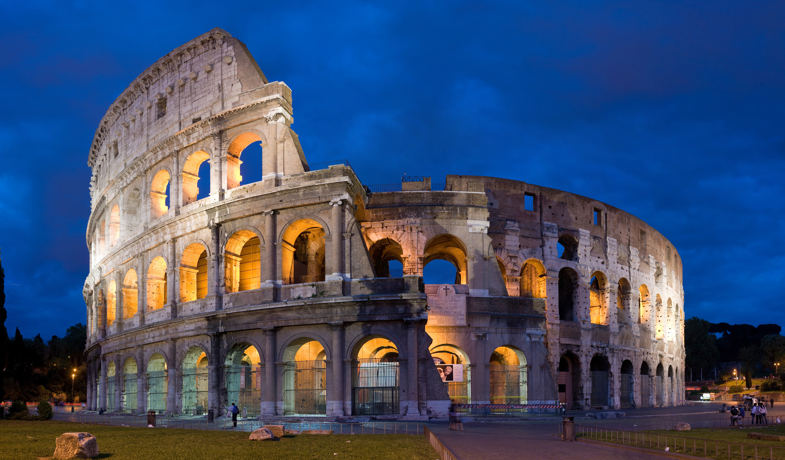
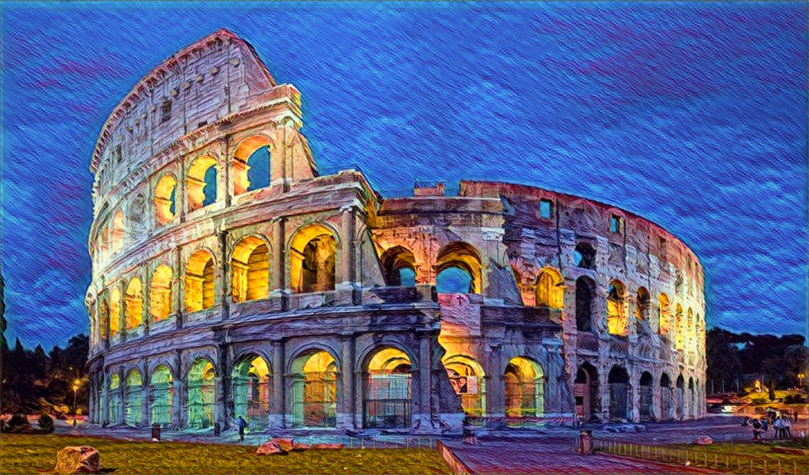

# 🎨 image-processing-experiment


>
> Beauty is a lure. — Dolores Abernathy, Westworld, SE01
>

## Demo

For Monet style 1:

Before



After




## Run it

```sh
docker compose up --build        # serves the function on http://127.0.0.1:8080
./run.sh process/raw_image/Rome.jpg monet 1
```

The result is written to `output/`. Styles are `monet` (index 0-9) and
`varied` (index 0-31).

Or call it directly:

```sh
curl -X POST -H 'X-Style-Name: varied' -H 'X-Style-Index: 12' \
     --data-binary @process/raw_image/Rome.jpg http://127.0.0.1:8080 > out.jpg

# blend two styles
curl -X POST -H 'X-Style-Name: varied' -H 'X-Which-Styles: {3: 0.5, 20: 0.5}' \
     --data-binary @process/raw_image/Rome.jpg http://127.0.0.1:8080 > blend.jpg
```

Images larger than `MAX_IMAGE_SIZE` (default 1600px on the long side) are
downscaled before stylization.

## How it works

`process/` is an OpenFaaS function: [of-watchdog](https://github.com/openfaas/of-watchdog)
in HTTP mode in front of a small Flask app. The style transfer network from
[A Learned Representation for Artistic Style](https://arxiv.org/abs/1610.07629)
is implemented in plain TensorFlow 2 (`process/function/model.py`) and reads
Magenta's pretrained multi-style pastiche generator checkpoints, which are
downloaded (and checksum-verified) at image build time. Models are loaded
once when the container starts.

To deploy to an OpenFaaS gateway instead (faasd or Kubernetes):

```sh
faas-cli up -f process.yml
URL=http://127.0.0.1:8080/function/process ./run.sh process/raw_image/Rome.jpg varied 12
```

## TODO

Try it with a web cam + UI to adjust the changes, kinda like what we see in magneta.

## Ref

- https://github.com/moby/moby
- https://github.com/openfaas/faas/tree/master/watchdog#working-with-http-headers
- https://github.com/tensorflow/magenta/blob/master/magenta/models/arbitrary_image_stylization/README.md
- https://ai.googleblog.com/2016/10/supercharging-style-transfer.html
- https://magenta.tensorflow.org/2016/11/01/multistyle-pastiche-generator
- https://blog.csdn.net/jiangmengya1/article/details/78266479
- https://jmkhael.io/unleash-the-artist-within-tensorflow-and-openfaas/
- https://blog.iron.io/docker-iron-io-super-easy-batch-processing/
- https://github.com/albarji/neural-style-docker
- https://github.com/h2non/imaginary


License
----

MIT
